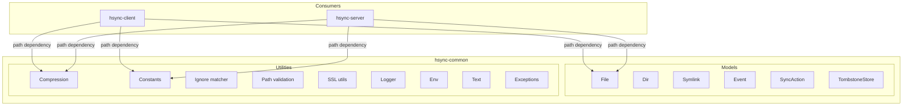

# HSYNC Common Architecture

This document describes the architecture of `hsync-common`, the shared library
that provides canonical models, constants, and compression utilities for the
HSYNC ecosystem.

> The *why* behind the ecosystem's stable, cross-project decisions is recorded
> in the [Architecture Decision Records](adr/README.md).

## System Overview



## Purpose

Before `hsync-common`, the client and server projects each maintained their own
copies of the data models (`File`, `Dir`, `Symlink`, `Event`, `SyncAction`),
compression logic, and constants. This led to:

- **Code duplication** — ~1 500 lines duplicated across the two projects.
- **Divergence risk** — changes in one project could silently diverge from
  the other, causing protocol incompatibilities.
- **Maintenance overhead** — every fix or improvement had to be applied twice.

`hsync-common` solves these issues by providing a single source of truth.

## Package Structure

```
hsync-common/
├── pyproject.toml              # Poetry configuration
├── README.md
├── docs/
│   └── architecture.md         # This file
└── hsync_common/
    ├── __init__.py
    ├── constants.py             # VERSION, sentinel/ignore/tombstone filenames, chunk sizes
    ├── compression.py           # Zstandard compress/decompress utilities
    ├── ignore.py                # .hsyncignore (gitignore-style) matcher
    ├── path_validation.py       # Filename/path traversal validation
    ├── ssl_utils.py             # Self-signed cert generation + fingerprinting
    ├── logger.py                # Shared loguru configuration
    ├── env.py                   # Environment-file loading helpers
    ├── text.py                  # Text utilities (e.g. loguru brace escaping)
    ├── exceptions.py            # Shared exception types
    └── models/
        ├── __init__.py          # Re-exports all models
        ├── file.py              # File model with SHA-256 caching
        ├── dir.py               # Dir model
        ├── symlink.py           # Symlink model
        ├── event.py             # Event + EventName enum
        ├── sync_action.py       # SyncAction + SyncActionName enum
        └── tombstone.py         # TombstoneStore (deletion markers, LWW merge)
```

## Models

### File

The `File` class represents a file with its synchronization metadata:

| Attribute     | Type             | Description                              |
|---------------|------------------|------------------------------------------|
| `filepath`    | `str \| None`    | Full path to the file                    |
| `name`        | `str \| None`    | Base filename (derived from filepath)    |
| `ctime`       | `int \| None`    | Creation time (Unix timestamp)           |
| `mtime`       | `int \| None`    | Modification time (Unix timestamp)       |
| `size`        | `int`            | File size in bytes                       |
| `sha256sum`   | `str \| None`    | SHA-256 checksum of file content         |
| `permissions` | `str \| None`    | Symbolic permission string               |

Key features:
- **SHA-256 caching** — in-memory cache keyed by `(filepath, mtime)` to avoid
  redundant hash computation within a sync cycle.
- **Adaptive chunk sizes** — SHA-256 computation uses 8 KB / 64 KB / 256 KB chunks
  depending on file size for optimal throughput.
- **`FileDict`** — a `TypedDict` for type-safe dictionary serialization.

### Dir

Represents a directory with `path` and `permissions`. Includes `is_hidden_dir()`
to detect dot-prefixed directories.

### Symlink

Represents a symbolic link with `filepath`, `target`, `name`, `ctime`, `mtime`.

### Event / EventName

Represents a file-system synchronization event. `EventName` is a `StrEnum` with
values: `added`, `modified`, `renamed`, `deleted`, `symlink`.

### SyncAction / SyncActionName

Represents a synchronization decision. `SyncActionName` is a `StrEnum` with
values: `download`, `upload`, `delete`, `nothing`.

### TombstoneStore

Records deletion markers so that a peer which was offline at deletion time does
not resurrect a file during a full reconciliation. Each entry maps a hashed
bucket-relative path to a `TombstoneEntry` (`ts`: deletion unix timestamp,
`sha256`: content hash of the removed file, or `None`).

Key features:
- **Last-writer-wins merge** — `merge()` and `record()` keep the newest `ts`,
  so server, LAN master and clients stay consistent.
- **Privacy-preserving keys** — paths are hashed (SHA-256) before storage.
- **TTL pruning** — `prune()` garbage-collects markers older than
  `TOMBSTONE_TTL_DAYS_DEFAULT` (30 days) so the store stays bounded.
- **JSON persistence** — atomic `save()`/`load()` to the `.hsynctombstones`
  side-car file, with a wire shape (`to_payload()`) reused by the REST endpoints
  and the Android client.

## Utilities

| Module             | Responsibility                                                  |
|--------------------|----------------------------------------------------------------|
| `ignore`           | `.hsyncignore` (gitignore-style) pattern matching              |
| `path_validation`  | Filename/path validation and traversal protection             |
| `ssl_utils`        | Self-signed certificate generation and fingerprint helpers     |
| `logger`           | Shared loguru configuration                                    |
| `env`              | Environment-file loading helpers                               |
| `text`             | Text helpers (e.g. escaping loguru braces)                     |
| `exceptions`       | Shared exception base types                                    |

## Compression

The `compression` module provides Zstandard (zstd) compression with level 3
(good speed/ratio balance):

| Function          | Description                                      |
|-------------------|--------------------------------------------------|
| `compress_data`   | Compress raw bytes                               |
| `decompress_data` | Decompress zstd-compressed bytes                 |
| `compress_file`   | Read and compress a file from disk               |
| `should_compress` | Decide if compression is beneficial (10 KB gate) |

The module also exports `PRECOMPRESSED_EXTENSIONS` — a frozen set of ~80 file
extensions that are already compressed (archives, images, audio, video, etc.).

**Project-specific extensions:**
- `hsync-client` adds upload (32 KB) and LAN (100 KB) thresholds.
- `hsync-server` adds async streaming compression for FastAPI handlers.

## Constants

| Constant                     | Value                | Description                              |
|------------------------------|----------------------|------------------------------------------|
| `VERSION`                    | `"1.0.0"`            | HSYNC protocol version (single source)   |
| `HSYNCKEEP_FILENAME`         | `".hsynckeep"`       | Sentinel file for empty-directory sync   |
| `HSYNCIGNORE_FILENAME`       | `".hsyncignore"`     | Per-bucket gitignore-style ignore file   |
| `HSYNCTOMBSTONES_FILENAME`   | `".hsynctombstones"` | Per-bucket deletion-marker side-car file |
| `TOMBSTONE_TTL_DAYS_DEFAULT` | `30`                 | Retention window before tombstone GC     |
| `CHUNK_SIZE_SMALL`           | 8 KB                 | SHA-256 chunk size for files < 1 MB      |
| `CHUNK_SIZE_MEDIUM`          | 64 KB                | SHA-256 chunk size for files < 100 MB    |
| `CHUNK_SIZE_LARGE`           | 256 KB               | SHA-256 chunk size for files ≥ 100 MB    |
| `FILE_SIZE_SMALL`            | 1 MB                 | Threshold for medium chunk size          |
| `FILE_SIZE_MEDIUM`           | 100 MB               | Threshold for large chunk size           |

## Integration

Both `hsync-client` and `hsync-server` declare a Poetry path dependency:

```toml
hsync-common = { path = "../hsync-common", develop = true }
```

Each project maintains **backward-compatible shim modules** that re-export
symbols from `hsync_common`. For example, in `hsync-client`:

```python
# hsync_client/models/file.py
from hsync_common.models.file import File, FileDict, clear_sha256_cache, ...
```

This ensures that all existing `from hsync_client.models.file import File`
and `from hsync_server.models.file import File` imports continue to work
without any changes to application code or tests.
