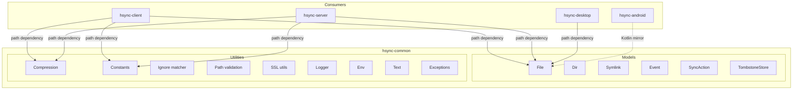

# HSYNC Common Architecture

This document describes the architecture of `hsync-common`, the shared library
that provides canonical models, constants, and compression utilities for the
HSYNC ecosystem.

> The *why* behind the ecosystem's stable, cross-project decisions is recorded
> in the [Architecture Decision Records](adr/README.md).

## System Overview



## Purpose

Before `hsync-common`, the client and server projects each maintained their own
copies of the data models (`File`, `Dir`, `Symlink`, `Event`, `SyncAction`),
compression logic, and constants. This led to:

- **Code duplication** — ~1 500 lines duplicated across the two projects.
- **Divergence risk** — changes in one project could silently diverge from
  the other, causing protocol incompatibilities.
- **Maintenance overhead** — every fix or improvement had to be applied twice.

`hsync-common` solves these issues by providing a single source of truth.

## Package Structure

```
hsync-common/
├── pyproject.toml              # Poetry configuration
├── README.md
├── docs/
│   ├── architecture.md         # This file
│   ├── lan-protocol.md         # LAN discovery/election/pairing/security spec
│   └── adr/                    # Architecture Decision Records
├── llm-wiki/                   # Agent-optimized knowledge base
└── hsync_common/
    ├── __init__.py
    ├── constants.py             # VERSION, sentinel/ignore/tombstone filenames, chunk sizes, delta constants
    ├── hashing.py               # SHA-256 helpers, adaptive chunk sizing, hex digest validation
    ├── compression.py           # Zstandard compress/decompress utilities
    ├── permissions.py           # Octal permission SSOT, remote permission sanitization
    ├── path_validation.py       # Filename/path traversal validation, remote-path validators
    ├── ignore.py                # .hsyncignore (gitignore-style) matcher
    ├── ssl_utils.py             # Self-signed cert generation + fingerprinting
    ├── logger.py                # Shared loguru configuration
    ├── clock.py                 # NTP-style clock offset computation
    ├── env.py                   # Environment-variable parsing helpers
    ├── format.py                # Human-readable bytes/duration formatting
    ├── text.py                  # Text utilities (e.g. loguru brace escaping)
    ├── exceptions.py            # Shared exception base types
    ├── models/
    │   ├── __init__.py          # Re-exports all models
    │   ├── file.py              # File model with SHA-256 caching
    │   ├── dir.py               # Dir model
    │   ├── symlink.py           # Symlink model
    │   ├── event.py             # Event + EventName enum
    │   ├── sync_action.py       # SyncAction + SyncActionName enum
    │   ├── tombstone.py         # TombstoneStore (deletion markers, LWW merge)
    │   ├── version.py           # SyncStateStore + FileVersion (3-way merge state)
    │   └── delta.py             # Delta transfer wire models (signatures, ops, instructions)
    ├── delta/                   # Rsync-style delta transfer algorithm
    │   ├── decision.py          # Block-size selection, is-delta-worthwhile heuristics
    │   └── rolling_checksum.py  # Adler32 rolling checksum, block matching
    └── protocol/
        ├── __init__.py          # Artifact path constants, dump/load helpers
        ├── handshake.py         # Protocol versions, capabilities, WS auth frames
        ├── capabilities.py      # Capabilities document (desktop UI gating)
        ├── events.py            # UiEventName enum, event build/serialize/parse
        ├── lan.py               # elect_master, election_sort_key
        ├── pairing.py           # evaluate_pin, lan_write_requires_key
        ├── schemas.py           # JSON-Schema builders (WS, LAN TXT)
        ├── fixtures.py          # Cross-language golden fixture generation
        ├── fixtures/             # Committed test scenarios (JSON)
        ├── rest/                # Generated OpenAPI snapshot (REST contract)
        ├── ws/                  # Generated WS JSON-Schema snapshot
        └── lan/                 # Generated LAN TXT JSON-Schema snapshot
```

## Models

### File

The `File` class represents a file with its synchronization metadata:

| Attribute     | Type             | Description                              |
|---------------|------------------|------------------------------------------|
| `filepath`    | `str \| None`    | Full path to the file                    |
| `name`        | `str \| None`    | Base filename (derived from filepath)    |
| `ctime`       | `int \| None`    | Creation time (Unix timestamp)           |
| `mtime`       | `int \| None`    | Modification time (Unix timestamp)       |
| `size`        | `int`            | File size in bytes                       |
| `sha256sum`   | `str \| None`    | SHA-256 checksum of file content         |
| `permissions` | `str \| None`    | Octal permission string (e.g. `"644"`)  |

Key features:
- **SHA-256 caching** — in-memory cache keyed by `(filepath, mtime)` to avoid
  redundant hash computation within a sync cycle.
- **Adaptive chunk sizes** — SHA-256 computation uses 8 KB / 64 KB / 256 KB chunks
  depending on file size for optimal throughput.
- **`FileDict`** — a `TypedDict` for type-safe dictionary serialization.

### Dir

Represents a directory with `path` and `permissions`. Includes `is_hidden_dir()`
which delegates to the active `IgnoreMatcher` to check whether a directory
should be excluded from synchronisation.

### Symlink

Represents a symbolic link with `filepath`, `target`, `name`, `ctime`, `mtime`.

### Event / EventName

Represents a file-system synchronization event. `EventName` is a `StrEnum` with
values: `added`, `modified`, `renamed`, `deleted`, `symlink`.

### SyncAction / SyncActionName

Represents a synchronization decision. `SyncActionName` is a `StrEnum` with
values: `download`, `upload`, `delete`, `delete_remote`, `nothing`.

### TombstoneStore

Records deletion markers so that a peer which was offline at deletion time does
not resurrect a file during a full reconciliation. Each entry maps a hashed
bucket-relative path to a `TombstoneEntry` (`ts`: deletion unix timestamp,
`sha256`: content hash of the removed file, or `None`).

Key features:
- **Last-writer-wins merge** — `merge()` and `record()` keep the newest `ts`,
  so server, LAN master and clients stay consistent.
- **Privacy-preserving keys** — paths are hashed (SHA-256) before storage.
- **TTL pruning** — `prune()` garbage-collects markers older than
  `TOMBSTONE_TTL_DAYS_DEFAULT` (30 days) so the store stays bounded.
- **Untrusted-payload validation** — `merge()` and `load()` accept only
  well-formed entries (SHA-256-hex keys and content hashes) with timestamps
  up to 5 minutes in the future, and the store is capped at 100 000 entries:
  a hostile peer cannot plant permanent or unbounded deletion markers through
  the gossip channel.
- **JSON persistence** — atomic `save()`/`load()` to the `.hsynctombstones`
  side-car file, with a wire shape (`to_payload()`) reused by the REST endpoints
  and the Android client.

### SyncStateStore / FileVersion

Backs the three-way merge conflict model. `SyncStateStore` persists per-file
base versions (the hash known to both peers) to the `.hsyncstate` side-car so
that conflicts are detected on the next reconciliation rather than by timestamp
alone. `FileVersion` is the `TypedDict` wire shape, and `resolve_three_way()`
compares base/local/remote hashes to pick keep/overwrite/conflict.

See [ADR 0006 — Master-authoritative conflict model](adr/0006-master-authoritative-conflict-model.md).

### Delta transfer models

Wire models for rsync-style block-level sync (`models/delta.py`):

| Model | Purpose |
|-------|---------|
| `BlockSignature` | Signature of a single base-file block (index, offset, length, weak Adler32, strong SHA-256) |
| `DeltaOp` | Reconstruction operation (copy from base or data from literal payload) |
| `DeltaInstructions` | Ordered operations to rebuild the new file from base + literals |
| `DeltaApplyMetadata` | Metadata for delta upload (cid, base/new SHA-256, block size, ops, …) |

Untrusted peer payloads are validated by dedicated sanitizers (`sanitize_*`)
before use. The core delta algorithm lives in the `hsync_common.delta` package
(rolling checksum + block matching + decision heuristics). See
[ADR 0016 — Delta transfer](adr/0016-delta-transfer.md).

## Utilities

| Module             | Responsibility                                                  |
|--------------------|----------------------------------------------------------------|
| `hashing`          | SHA-256 computation, adaptive chunk sizing, hex digest validation |
| `compression`      | Zstandard compress/decompress, decompression-bomb protection   |
| `permissions`      | Octal permission SSOT, remote permission sanitization           |
| `path_validation`  | Filename/path validation, traversal protection, remote-path validators |
| `ignore`           | `.hsyncignore` (gitignore-style) pattern matching              |
| `ssl_utils`        | Self-signed certificate generation and fingerprint helpers     |
| `logger`           | Shared loguru configuration                                    |
| `clock`            | NTP-style clock offset computation                             |
| `format`           | Human-readable bytes/duration formatting                        |
| `env`              | Environment-file loading helpers                               |
| `text`             | Text helpers (e.g. escaping loguru braces)                     |
| `exceptions`       | Shared exception base types                                    |

## Compression

The `compression` module provides Zstandard (zstd) compression with level 3
(good speed/ratio balance):

| Function          | Description                                      |
|-------------------|--------------------------------------------------|
| `compress_data`   | Compress raw bytes                               |
| `decompress_data` | Decompress zstd-compressed bytes (optional hard cap on output size for untrusted payloads) |
| `compress_file`   | Read and compress a file from disk               |
| `should_compress` | Decide if compression is beneficial (10 KB gate) |

The module also exports `PRECOMPRESSED_EXTENSIONS` — a frozen set of ~80 file
extensions that are already compressed (archives, images, audio, video, etc.).

**Project-specific extensions:**
- `hsync-client` adds upload (32 KB) and LAN (100 KB) thresholds.
- `hsync-server` adds async streaming compression for FastAPI handlers.

### Protocol Negotiation

Compression support is negotiated between peers during connection setup:

- **Server Mode**: The server advertises compression capability during the
  WebSocket handshake via the `X-HSync-Compression: zstd` response header.
  The client reads this header and enables compression for subsequent file
  transfers. The `/health` endpoint also returns `{"compression": true}` in
  its JSON response.
- **LAN Mode**: Peers advertise compression support via mDNS TXT records
  (`compression=zstd`). During master election, the elected master's
  compression capability is propagated to all slaves.

If either side does not advertise compression, transfers fall back to
uncompressed mode transparently.

## Path Validation

The `path_validation` module provides safety checks used by both client and
server to prevent path manipulation attacks:

| Check | Description |
|-------|-------------|
| Path traversal | Rejects paths containing `../` or absolute paths that could escape the bucket directory |
| Null bytes | Rejects paths with embedded null bytes (`\0`) |
| Symlink escape | Validates that resolved symlink targets stay within the allowed directory |
| Component validation | Rejects empty path components and reserved names |
| Length limits | Enforces maximum path and filename length limits |

These checks are applied at every filesystem boundary — file upload, download,
listing, and deletion — ensuring that a malicious or misconfigured client
cannot write files outside the bucket directory.

## Ignore Matcher (`IgnoreMatcher`)

The `ignore` module provides gitignore-style pattern matching for excluding
files from synchronization. It supports the full gitignore specification:

| Feature | Syntax | Example |
|---------|--------|---------|
| Wildcard | `*` | `*.log` — matches all `.log` files |
| Directory-only | trailing `/` | `build/` — matches `build/` directory only |
| Recursive glob | `**` | `**/__pycache__/` — matches `__pycache__` at any depth |
| Negation | `!` | `!important.log` — re-includes a previously excluded file |
| Root-anchored | leading `/` | `/dist/` — matches only at the bucket root |

### Layered matching

`IgnoreMatcher` combines three layers:

1. **Default ignore patterns** — built-in gitignore-style patterns for
   operating-system cache files (`.DS_Store`, `Thumbs.db`, ...) and
   editor/office temporary files. These are **always active** and cannot be
   disabled, following the industry standard (Syncthing, rsync, Nextcloud,
   OneDrive). Dotfiles in general (`.env`, `.config`, `.git/` ...) are **not**
   excluded: they are synchronised normally.
2. **Per-bucket `.hsyncignore`** — user-defined rules in the bucket root.
3. **Extra patterns** — programmatic patterns from `--ignore-patterns` CLI flag.

The sentinel `.hsynckeep` file is always preserved regardless of any pattern.
Engine-owned artifacts (`.hsyncignore`, `.hsyncstate`, `.hsynctombstones`,
`*.part`) are always excluded.

## Constants

| Constant                     | Value                | Description                              |
|------------------------------|----------------------|------------------------------------------|
| `VERSION`                    | `"1.0.0"`            | HSYNC protocol version (single source)   |
| `HSYNCKEEP_FILENAME`         | `".hsynckeep"`       | Sentinel file for empty-directory sync   |
| `HSYNCIGNORE_FILENAME`       | `".hsyncignore"`     | Per-bucket gitignore-style ignore file   |
| `HSYNCTOMBSTONES_FILENAME`   | `".hsynctombstones"` | Per-bucket deletion-marker side-car file |
| `HSYNCSTATE_FILENAME`        | `".hsyncstate"`      | Per-bucket 3-way merge state side-car    |
| `PARTIAL_DOWNLOAD_SUFFIX`    | `".part"`            | Suffix for in-progress downloads         |
| `TOMBSTONE_TTL_DAYS_DEFAULT` | `30`                 | Retention window before tombstone GC     |
| `CHUNK_SIZE_SMALL`           | 8 KB                 | SHA-256 chunk size for files < 1 MB      |
| `CHUNK_SIZE_MEDIUM`          | 64 KB                | SHA-256 chunk size for files < 100 MB    |
| `CHUNK_SIZE_LARGE`           | 256 KB               | SHA-256 chunk size for files ≥ 100 MB    |
| `FILE_SIZE_SMALL`            | 1 MB                 | Threshold for medium chunk size          |
| `FILE_SIZE_MEDIUM`           | 100 MB               | Threshold for large chunk size           |
| `DELTA_MIN_FILE_SIZE`        | 256 KB               | Minimum file size to attempt delta sync  |
| `DELTA_MIN_FILE_SIZE_LAN`    | 1 MB                 | Minimum file size for LAN delta sync     |
| `DELTA_MAX_CHANGE_RATIO`     | `0.50`               | Max changed-block ratio for delta sync   |
| `DELTA_TOKEN_TTL`            | 300 s                | Delta token expiry (single-use)          |

## Integration

`hsync-client`, `hsync-server`, and `hsync-desktop` all declare a Poetry path
dependency:

```toml
hsync-common = { path = "../hsync-common", develop = true }
```

Consumers import shared symbols directly from `hsync_common.*` — there are no
compatibility shims or re-export modules. Per the project's *Zero Backward
Compatibility* stance, a contract change in `hsync-common` is applied
atomically across all consumers:

```python
# Direct import — no shim layer
from hsync_common.models.file import File, FileDict
from hsync_common.protocol.handshake import PROTOCOL_VERSION_REST
```

The Android app does not import Python; it mirrors the SSOT in Kotlin and the
shared fixtures pin both languages to identical behavior.
